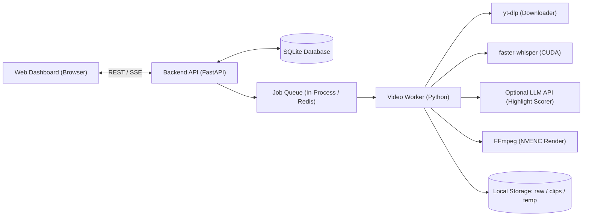

# Technical Design Document (TDD) — Clipper Tools

## 1. Arsitektur Tingkat Tinggi (High-Level Architecture)

Aplikasi berjalan secara lokal dengan pola **API + Background Worker** agar proses download, transkripsi, dan render video yang berat tidak memblokir antarmuka web.



---

## 2. Pemilihan Tech Stack

| Komponen | Teknologi | Alasan Pemilihan |
| :--- | :--- | :--- |
| **Backend & Worker** | Python 3.11+ + FastAPI | Ekosistem terbaik untuk AI/ML (`faster-whisper`), pengolahan audio/video, dan integrasi CLI tools. |
| **Frontend (Web UI)** | Next.js / React (atau Vite + React + Tailwind) | Ringan, responsif, mudah membuat video preview & editor subtitle interaktif. |
| **Database** | SQLite (via SQLAlchemy / SQLModel) | Zero-setup untuk aplikasi lokal, cukup kuat untuk single-node / tim internal. |
| **Job Queue** | `arq` / Redis atau Python `ThreadPool`/`ProcessPool` + DB state | Untuk MVP lokal, worker queue berbasis SQLite/Redis menjaga antrean tetap rapi tanpa kompleksitas berlebih. |
| **Downloader** | `yt-dlp` | Standar industri paling stabil untuk YouTube, Twitch, dan Kick. |
| **Speech-to-Text** | `faster-whisper` (CTranslate2 + CUDA) | Jauh lebih cepat dan hemat VRAM dibanding Whisper original, sangat akurat untuk ID & EN. |
| **Video Engine** | `FFmpeg` (`h264_nvenc`) | Memanfaatkan GPU NVIDIA untuk encoding 5–10x lebih cepat dibanding CPU (`libx264`). |
| **Subtitle Format** | `.ass` (Advanced SubStation Alpha) | Mendukung styling modern (highlight kata aktif, outline tebal, posisi presisi) langsung saat burn-in oleh FFmpeg. |

---

## 3. Alur Pipeline Pemrosesan Video

Setiap `Job` melewati 5 tahap terpisah dan statusnya disimpan di database sehingga bisa dipantau atau di-retry jika gagal:

1. **Ingest (`downloading`)**
   * Jika input URL: unduh video kualitas terbaik (maksimal `1080p` agar ukuran file efisien) menggunakan `yt-dlp`.
   * Jika input file lokal: pindahkan/referensikan ke folder kerja job.
   * Ekstrak audio mono 16kHz (`.wav`) menggunakan `FFmpeg` untuk kebutuhan analisis suara & transkripsi.
2. **Transcribe (`transcribing`)**
   * Jalankan `faster-whisper` (model `medium` atau `large-v3-turbo` di CUDA `float16`) dengan `word_timestamps=True`.
   * Simpan hasil transkrip lengkap beserta timestamp per kata ke `transcript.json`.
3. **Highlight Detection (`analyzing`)**
   * **Sinyal 1 (Audio Energy):** Hitung RMS/dB spike per jendela 1 detik untuk mendeteksi momen teriakan, tawa, ledakan, atau aksi intens.
   * **Sinyal 2 (Transkrip & LLM Opsional):**
     * Jika API LLM aktif: kirim segmen transkrip + skor audio spike untuk memilih `N` segmen terbaik sesuai target durasi (`30–60s`), lengkap dengan skor & judul.
     * Jika mode 100% lokal: gabungkan skor puncak audio + kepadatan kata/kalimat untuk menentukan kandidat segmen `start_time` dan `end_time`.
   * Simpan kandidat klip ke tabel `clips` dengan status `ready_to_edit`.
4. **Preview & Edit Ringan (`editing`)**
   * User dapat menggeser `start_time` / `end_time`, mengedit teks kata di transkrip klip, atau menyesuaikan koordinat *crop box* facecam (untuk mode *Split-Screen*).
5. **Render Final (`rendering` → `completed`)**
   * Generate file subtitle `.ass` khusus untuk rentang waktu klip dengan efek *active word highlight*.
   * Jalankan `FFmpeg` dengan filter grafis:
     * **Fullscreen 9:16:** `crop=ih*9/16:ih,scale=1080:1920,ass=sub.ass`
     * **Split-Screen:** Crop area facecam (skala ke `1080x640` di atas) + crop area gameplay (skala ke `1080x1280` di bawah), gabungkan dengan `vstack`, lalu burn-in `ass=sub.ass`.
   * Encode menggunakan `h264_nvenc` (`-preset p4 -cq 20`) untuk kecepatan maksimal dengan kualitas tajam.

---

## 4. Skema Database (SQLite)

### Tabel `jobs`
* `id` (UUID / String, PK)
* `source_type` (`url` | `local_file`)
* `source_value` (URL atau path file)
* `title` (String)
* `language` (`auto` | `id` | `en`)
* `layout_mode` (`fullscreen` | `split_screen`)
* `layout_config_json` (Koordinat crop facecam & gameplay jika split-screen)
* `status` (`queued` | `downloading` | `transcribing` | `analyzing` | `ready` | `rendering` | `completed` | `failed`)
* `progress` (Integer `0–100`)
* `error_message` (Text, nullable)
* `raw_video_path` (String)
* `created_at`, `updated_at`

### Tabel `clips`
* `id` (UUID / String, PK)
* `job_id` (FK → `jobs.id`)
* `title` (String)
* `start_time` (Float, detik)
* `end_time` (Float, detik)
* `score` (Float)
* `subtitle_json` (JSON array kata & timestamp untuk diedit di UI)
* `output_path` (String, nullable)
* `status` (`draft` | `rendering` | `done` | `failed`)

---

## 5. Desain API Endpoints (FastAPI)

* `POST /api/jobs` — Membuat job baru (URL atau multipart file upload + konfigurasi).
* `GET /api/jobs` — Daftar semua job beserta status dan progres.
* `GET /api/jobs/{job_id}` — Detail job, frame preview (untuk set kotak facecam), dan daftar kandidat klip.
* `PATCH /api/clips/{clip_id}` — Simpan hasil edit `start_time`, `end_time`, atau teks subtitle.
* `POST /api/clips/{clip_id}/render` — Trigger render final 1 klip (atau `render-all` per job).
* `GET /api/clips/{clip_id}/download` — Download file `.mp4` hasil render.
* `DELETE /api/jobs/{job_id}/raw` — Hapus file video mentah untuk menghemat ruang disk tanpa menghapus hasil klip.

---

## 6. Struktur Folder Proyek yang Disarankan

```text
Clipper-tools/
├── docs/
│   ├── PRD.md
│   └── TDD.md
├── backend/
│   ├── app/
│   │   ├── main.py          # FastAPI entrypoint
│   │   ├── config.py        # Env & path settings
│   │   ├── database.py      # SQLite setup & models
│   │   ├── api/             # Route handlers
│   │   ├── services/        # yt-dlp, whisper, audio_analyzer, llm_scorer, ffmpeg_renderer, ass_generator
│   │   └── workers/         # Background job runner
│   └── requirements.txt
├── frontend/                # React + Vite + Tailwind Web Dashboard
└── storage/                 # Git-ignored (raw/, temp/, outputs/)
```

---

## 7. Risiko Teknis & Mitigasi

1. **`yt-dlp` gagal mengunduh karena perubahan YouTube/Twitch/Kick:**
   * *Mitigasi:* Selalu pin versi `yt-dlp` yang mudah di-update (`pip install -U yt-dlp`) dan sediakan opsi upload file lokal sebagai fallback instan.
2. **VRAM GPU penuh saat menjalankan `faster-whisper`:**
   * *Mitigasi:* Gunakan `compute_type="float16"` atau `"int8_float16"` dan pastikan model di-unload / dibersihkan dari VRAM sebelum tahap render paralel, serta jalankan worker secara sekuensial (1 job berat dalam satu waktu).
3. **Penyimpanan SSD cepat penuh oleh VOD berjam-jam:**
   * *Mitigasi:* Batasi download ke `1080p` (hindari 4K kecuali diminta) dan sediakan fitur auto-delete file mentah setelah semua klip selesai di-render.
